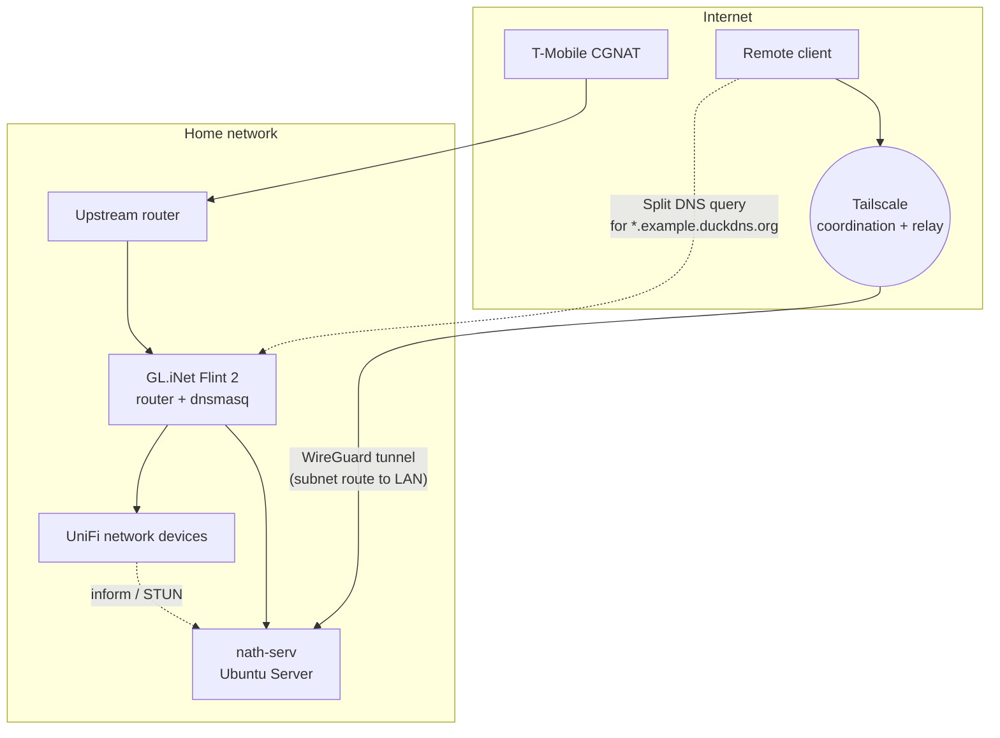
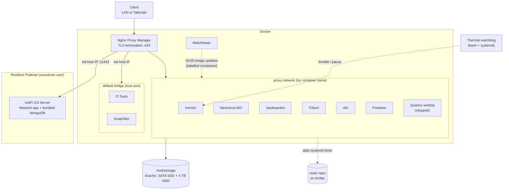

# Homelab

A single self-hosted server I built, hardened, and maintain as a hands-on project in systems administration, networking, and containers. This repo documents it the way I'd hand it off to another engineer: what runs, how it is wired together, why it is set up that way, and what currently needs fixing.

> **Snapshot:** this documentation reflects a full audit of the live host on **2026-10-13**. Open issues found during that audit are tracked in [`docs/findings.md`](docs/findings.md).

## At a glance

| | |
|---|---|
| Host | `nath-serv`, Gigabyte B450 AORUS M, Ryzen 5 2600X (6c/12t), 32 GB RAM |
| OS | Ubuntu Server 26.04.1 LTS, kernel 7.0 |
| Storage | 238 GB NVMe (OS, Docker, backups) + 3.6 TB HDD cached by a 112 GB SATA SSD (bcache, writeback) |
| Containers | Docker 29.8 with Compose v5: 7 Compose projects, 19 running containers |
| Also on the host | UniFi OS Server 5.1 (vendor-managed rootless Podman), Tailscale subnet router |
| Access | LAN and Tailscale only; nothing is port-forwarded from the internet |
| Load | ~1% CPU and ~7 GB RAM at idle |

## Highlights

- **Reverse-proxied Docker stack.** Nginx Proxy Manager terminates TLS with a wildcard Let's Encrypt certificate (DNS-01 via DuckDNS). Application containers join a shared `proxy` network and are reached by container name instead of publishing ports.
- **Remote access without open ports.** The host is a Tailscale subnet router for the LAN. Split-horizon DNS makes the same hostnames resolve to the proxy on and off the LAN.
- **Tiered storage.** bcache puts a SATA SSD in front of a 4 TB HDD in writeback mode, so bulk data lives on cheap disk with SSD-speed hot paths.
- **Thermal watchdog.** A bash service throttles, then pauses, the photo library's ML workload before the CPU reaches its shutdown limit.
- **Host hardening.** UFW, fail2ban on SSH, root login disabled, a single allowed SSH user, unattended security updates.
- **Daily backups by design.** `pg_dump` plus restic on a systemd timer. This job is currently failing; see [findings](docs/findings.md#1-nightly-backups-have-been-failing-since-2026-09-22).

## Architecture

### Network and remote access



### Host: services, storage, backups



**Traffic flow:** clients reach services by hostname (`*.example.duckdns.org`). On the LAN, the router's dnsmasq answers those names with the host's LAN address. Off the LAN, Tailscale advertises the LAN subnet and uses Split DNS to send queries for that domain to the same router. Nginx Proxy Manager terminates TLS and forwards to the right backend.

More detail: [`docs/architecture.md`](docs/architecture.md)

## Services

| Service | Purpose | Runs as | Hostname |
|---|---|---|---|
| Nginx Proxy Manager 2.16 | Reverse proxy, wildcard TLS | Compose `homelab-core` | `npm.` |
| Portainer CE 2.45 | Container management UI | Compose `homelab-core` | `ptnr.` |
| Watchtower 1.21 | Scheduled image updates (opt-in by label) | Compose `homelab-core` | – |
| Immich 3.1 | Photo library with ML search | Compose `immich` | `immich.` |
| Nextcloud AIO (Nextcloud 34) | Files and documents | Compose `nextcloud` + AIO-managed containers | `cloud.` |
| Vaultwarden 1.37 | Password manager | Compose `vaultwarden` | `vault.` |
| Trilium 0.106 | Notes | Compose `trilium` | `notes.` |
| n8n 2.36 | Workflow automation | Compose `n8n` | `n8n.` |
| IT-Tools | Developer utilities | `docker run` | `it.` |
| SnapOtter 2.2 | File conversion, OCR, local AI tools | `docker run` | `tools.` |
| Quartus webtop | Intel Quartus 13.0sp1 in a browser desktop (stopped) | Compose `quartus` (local build) | `quartus.` |
| UniFi OS Server 5.1 | UniFi network controller | Rootless Podman, systemd | `unifi.` |
| Tailscale 1.102 | Remote access, subnet router | Host package | – |

Full catalog with images, data paths, and update policy: [`docs/services.md`](docs/services.md)

## Documentation

| Document | Contents |
|---|---|
| [`docs/architecture.md`](docs/architecture.md) | How the pieces fit: request path, trust boundaries, design decisions |
| [`docs/host.md`](docs/host.md) | Hardware, OS, packages, systemd units and timers, users |
| [`docs/networking.md`](docs/networking.md) | LAN, DNS, Tailscale, Docker networks, listening ports, proxy hosts |
| [`docs/services.md`](docs/services.md) | Per-service reference |
| [`docs/storage-and-backups.md`](docs/storage-and-backups.md) | Disk layout, bcache, data locations, backup design and restore |
| [`docs/hardening.md`](docs/hardening.md) | SSH, firewall, fail2ban, updates, container exposure |
| [`docs/operations.md`](docs/operations.md) | Runbook: health checks, updates, restarts, recovery |
| [`docs/findings.md`](docs/findings.md) | Audit findings and recommended fixes, by priority |

## Repository layout

```
compose/    Docker Compose files as deployed (secrets replaced by .env.example)
scripts/    Thermal watchdog, backup script, and their systemd units
system/     sysctl drop-ins, Tailscale GRO unit, wait-for-internet unit, Docker and fail2ban config
docs/       Architecture, host, networking, services, storage, hardening, operations, findings
```

## Design decisions

| Decision | Why | Where |
|---|---|---|
| Pin the `proxy` network subnet | An auto-assigned range changed after a daemon state reset and broke containers with static addresses ("address already in use") | [`compose/homelab-core`](compose/homelab-core/docker-compose.yml) |
| Tiered throttle/pause watchdog | An ML workload drove the CPU to its thermal shutdown limit | [`scripts/thermal-watchdog.sh`](scripts/thermal-watchdog.sh) |
| Split-horizon DNS | Double NAT and inherited WAN DNS broke name resolution after moving to Tailscale | [`docs/networking.md`](docs/networking.md#dns) |
| Hold Docker back until public DNS resolves | `systemd-networkd-wait-online` is not a reliable signal on this network, so a small unit gates `docker.service` on a real lookup | [`system/wait-for-internet.service`](system/wait-for-internet.service) |
| UniFi on UniFi OS Server, outside Docker | The controller used to run as a Docker container, where Layer 2 device discovery does not cross the bridge and adoption needed a manual `set-inform`. The vendor package publishes its ports on the host directly | [`docs/services.md`](docs/services.md#unifi-os-server) |

## Lessons learned

- Pin Docker network subnets explicitly; auto-assigned ranges can change after a daemon state reset and silently break anything with a static IP.
- Failures can be masked by another layer. DNS problems only surfaced once a tool that had been intercepting DNS was replaced.
- Keep the stack small. Fewer services doing their jobs well beats a sprawl of half-maintained ones.
- Monitor before you need to. The thermal issue was caught only after a forced shutdown; the watchdog now handles it before that point.
- A backup job that fails silently is not a backup. Migrating one service broke the nightly job for every service, and nothing alerted on it.

## Notes

Domains, LAN addresses, usernames, and credentials in this repo are placeholders (`example.duckdns.org`, `192.168.1.0/24`, `admin`). Docker-internal subnets are real because they matter to the design. No real secrets are committed.
