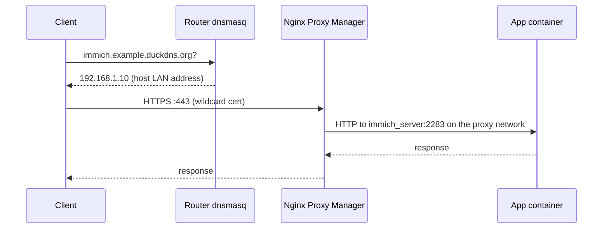

# Architecture

How the host is put together and why. For exact values see [host](host.md), [networking](networking.md), [services](services.md), and [storage and backups](storage-and-backups.md).

## Layers

| Layer | What is there |
|---|---|
| Hardware | One desktop-class machine: Ryzen 5 2600X, 32 GB RAM, NVMe + SATA SSD + 4 TB HDD, one 1 GbE port |
| OS | Ubuntu Server 26.04 LTS, systemd-networkd, DHCP address on the LAN |
| Host services | SSH, UFW, fail2ban, Tailscale, chrony, smartd, unattended-upgrades, two custom units (thermal watchdog, backup timer) |
| Container runtimes | Docker (root daemon) for everything self-managed; rootless Podman only for the vendor-packaged UniFi OS Server |
| Edge | Nginx Proxy Manager is the single HTTP(S) entry point, bound to the LAN address |
| Applications | Immich, Nextcloud AIO, Vaultwarden, Trilium, Obsidian LiveSync (CouchDB), n8n, Portainer, IT-Tools, SnapOtter, Quartus, UniFi |
| Data | OS, images, named volumes, and the backup repo on NVMe; application data on the bcache volume at `/mnt/storage` |

## Request path

A remote client follows the same path. Tailscale routes `192.168.1.0/24` through the host (subnet router), and Tailscale Split DNS forwards queries for the domain to the router, so the hostname resolves to the same LAN address and the same certificate is valid.

Three kinds of backend sit behind the proxy:

1. **Containers on the `proxy` network**, addressed by container name. No host port is published. This is the default pattern.
2. **Containers on Docker's default bridge** (IT-Tools, SnapOtter), addressed through a published host port. These were started with `docker run` and have not been moved into Compose.
3. **UniFi OS Server**, which is not a Docker container. The proxy reaches it at the host address on port 11443 over HTTPS.

## Trust boundaries

- **Internet to host:** no inbound path. The ISP uses CGNAT, nothing is port-forwarded, and Tailscale connections are outbound.
- **LAN and tailnet to host:** UFW filters traffic to host processes (SSH and the UniFi OS Server ports). Docker-published ports are filtered by Docker's own rules, not UFW, so their bind address is what scopes them. See [hardening](hardening.md#docker-and-the-firewall).
- **Proxy to apps:** plain HTTP inside the `proxy` bridge network. Every container on that network can reach every other one.
- **Docker socket:** Portainer and Watchtower mount it read-write, and the Nextcloud AIO master container read-only. Any of these is equivalent to root on the host if compromised.

## Design decisions

### One shared `proxy` network with a pinned subnet

Every proxied application joins an external network called `proxy`, created by the `homelab-core` project with an explicit IPv4 subnet (`172.18.0.0/16`) and IPv6 ULA subnet. Pinning matters because Nginx Proxy Manager has a static address on it (`172.18.0.10`); if Docker re-assigns the range, static addresses stop being valid and unrelated containers fail to start with "address already in use".

Consequence: any other static address on that network must be kept free. See [finding 5](findings.md#5-homelab-core-compose-file-has-drifted-from-what-is-deployed).

### TLS by DNS-01 with a wildcard certificate

Because nothing is reachable from the internet, HTTP-01 validation is impossible. Nginx Proxy Manager uses the DuckDNS DNS-01 plugin to obtain one certificate for `*.example.duckdns.org` (ECDSA, Let's Encrypt), shared by all 12 proxy hosts. Public DNS only needs to hold the TXT challenge.

### Tailscale subnet router rather than a per-service VPN

The host advertises the whole LAN subnet. Remote devices need no per-service configuration and reach the UniFi devices and router as well. The cost is that a tailnet device has LAN-wide reach, so access is controlled by tailnet membership and ACLs.

The host does not accept tailnet DNS itself (`CorpDNS` off); it keeps using the router. Two supporting pieces live in [`system/`](../system):

- `99-tailscale.conf` enables IPv4 and IPv6 forwarding.
- `tailscale-gro.service` turns on UDP GRO forwarding on the NIC before `tailscaled` starts, which Tailscale recommends for subnet-router throughput.

### bcache in writeback mode

Application data sits on a 4 TB HDD with a 112 GB SATA SSD as cache. Writeback mode acknowledges writes once they hit the SSD, which gives the best latency but means the SSD briefly holds the only copy of recent writes. That trade-off is only acceptable with working backups. See [storage and backups](storage-and-backups.md#bcache).

### Thermal watchdog

Immich's machine-learning jobs can pin all 12 threads for long periods. `thermal-watchdog.service` polls the CPU temperature every 5 seconds and reacts in two tiers: at 80 °C it applies `cpulimit` to Python processes; at 85 °C it pauses the Immich server and ML containers until the CPU cools to 65 °C. See [`scripts/thermal-watchdog.sh`](../scripts/thermal-watchdog.sh).

### Opt-in automatic updates

Watchtower runs daily at 04:00 with `WATCHTOWER_LABEL_ENABLE=true`, so only containers that carry the enable label are updated. Immich is not labelled, and Nextcloud AIO marks its own containers as excluded because it has its own upgrade procedure. The exact coverage is in [services](services.md#update-policy).

### UniFi OS Server on the host

The UniFi controller is installed from Ubiquiti's UniFi OS Server package. It runs as a dedicated `uosserver` user in a rootless Podman container with its own bundled MongoDB, and forwards its ports with `pasta`. It is managed by `uosserver.service` and updates itself through `uosserver-updater.service`. It is independent of Docker and of the Compose files in this repo.
