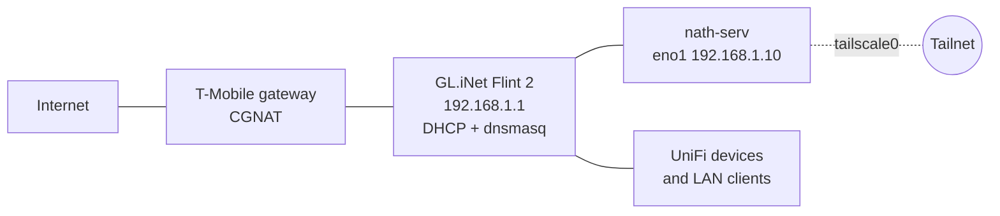

# Networking

Addresses on the LAN are placeholders (`192.168.1.0/24`, host at `192.168.1.10`). Docker subnets are real.

## Topology

- The ISP gateway does carrier-grade NAT, so the home network has no public IPv4 address and cannot accept inbound connections. The Flint 2 sits behind it (double NAT).
- The host has one wired interface, `eno1`, configured by DHCP through netplan and systemd-networkd. Its address should be reserved on the router, because Compose files and proxy hosts refer to it literally.
- `eno1` also holds a global IPv6 address from the ISP prefix and a ULA address from the router.

## DNS

| Where | What resolves names |
|---|---|
| On the host | systemd-resolved stub, forwarding to the router (`192.168.1.1`) |
| LAN clients | Router dnsmasq |
| Tailnet clients | Tailscale Split DNS sends `example.duckdns.org` to the router; everything else uses the client's normal DNS |

The service domain is a DuckDNS subdomain. Every hostname under it resolves to the host's LAN address, `192.168.1.10`. That works for remote clients too, because Tailscale routes the LAN subnet.

The host itself has `CorpDNS` disabled in Tailscale, so it never takes DNS settings from the tailnet.

Public DNS for the domain is only needed for the Let's Encrypt DNS-01 TXT challenge. It also currently carries an out-of-date AAAA record; see [finding 7](findings.md#7-stale-aaaa-record-in-public-dns).

## Tailscale

| Setting | Value |
|---|---|
| Version | 1.102.4, auto-update enabled |
| Role | Subnet router, advertising `192.168.1.0/24` |
| Key expiry | Disabled for this node |
| Accept routes | No |
| Accept DNS | No |
| Tailscale SSH | Off |
| Exit node | Not offered, not used |
| Serve / Funnel | Not configured |
| Peers | 2 (a laptop and a phone) |

Supporting host configuration:

- [`system/99-tailscale.conf`](../system/99-tailscale.conf): IP forwarding.
- [`system/tailscale-gro.service`](../system/tailscale-gro.service): UDP GRO forwarding on `eno1`. Verified active: `rx-udp-gro-forwarding: on`, `rx-gro-list: off`.
- UFW was configured with `allow in on tailscale0`, so tailnet traffic is not filtered per port.

The earlier remote-access tool was Twingate. Its connector is still defined in the `homelab-core` Compose file but is not deployed; see [finding 5](findings.md#5-homelab-core-compose-file-has-drifted-from-what-is-deployed).

## Docker networks

| Network | Subnet | IPv6 | Used by |
|---|---|---|---|
| `proxy` | `172.18.0.0/16`, gateway `.1` | `fd00:dead:cafe::/64` | 11 containers: NPM and every proxied app. External network, created by `homelab-core` |
| `bridge` (default) | `172.17.0.0/16` | `fd00:dead:beef::/64` | IT-Tools, SnapOtter |
| `nextcloud-aio` | `172.19.0.0/16` | – | Nextcloud AIO child containers. Created by AIO |
| `homelab-core_default` | `172.21.0.0/16` | – | Watchtower |
| two unused networks | `172.20.0.0/24`, `172.22.0.0/16` | – | Left over from retired stacks; no containers attached |

Addresses on `proxy` at audit time. Only NPM's is static; the rest are assigned at start and can change.

| Container | Address |
|---|---|
| `npm` | `172.18.0.10` (static) |
| `n8n` | `172.18.0.3` |
| `immich_postgres` | `172.18.0.4` |
| `portainer` | `172.18.0.5` |
| `immich_server` | `172.18.0.6` |
| `nextcloud-aio-mastercontainer` | `172.18.0.7` |
| `vaultwarden` | `172.18.0.8` |
| `immich_machine_learning` | `172.18.0.9` |
| `immich_redis` | `172.18.0.11` |
| `nextcloud-aio-apache` | `172.18.0.12` |

Note that `immich_postgres` and `immich_redis` are on the shared `proxy` network rather than a private one, because the Immich Compose file attaches every service to `proxy`.

## Reverse proxy hosts

All hosts listen on 80 and 443, force HTTPS, and use the same wildcard certificate (`*.example.duckdns.org`, ECDSA, Let's Encrypt, renewed by DNS-01; current certificate valid until 2027-01-09). None has an access list.

| Hostname | Backend | Scheme | Notes |
|---|---|---|---|
| `npm.` | `npm:81` | http | NPM admin UI |
| `ptnr.` | `portainer:9000` | http | |
| `immich.` | `immich_server:2283` | http | |
| `cloud.` | `nextcloud-aio-apache:11000` | http | |
| `vault.` | `vaultwarden:80` | http | |
| `notes.` | `trilium:8080` | http | Trilium was removed on 2026-10-25, so this returns 502. Delete the host in the NPM UI |
| `obsidian.` | `couchdb:5984` | http | Obsidian LiveSync. Advanced config: `proxy_buffering off`, `client_max_body_size 50M`, long read timeout |
| `n8n.` | `n8n:5678` | http | |
| `quartus.` | `quartus:3000` | http | Backend container is stopped, so this returns 502 |
| `it.` | `192.168.1.10:8097` | http | Backend on default bridge, reached through its host port |
| `tools.` | `192.168.1.10:1349` | http | Same pattern (SnapOtter) |
| `unifi.` | `192.168.1.10:11443` | https | UniFi OS Server; "block common exploits" is off for this host |

## Listening ports on the host

### Host processes

| Port | Bind | Process | Purpose |
|---|---|---|---|
| 22/tcp | all | `sshd` | SSH |
| 53 | loopback | `systemd-resolved` | Stub resolver |
| 323/udp | loopback | `chronyd` | Control socket |
| 27017/tcp | loopback | `mongod` | Unused host MongoDB (see [finding 11](findings.md#11-leftovers-from-retired-setups)) |
| 41641/udp | all | `tailscaled` | WireGuard |
| 10001/udp | all | `discovery` (UniFi OS Server, runs on the host as `uosserver`) | UniFi device discovery |
| 11002/tcp | loopback | `discovery` | Local control port |
| high tcp port | Tailscale address | `tailscaled` | PeerAPI |

### Docker-published ports

| Port | Bind | Container | Purpose |
|---|---|---|---|
| 80, 443/tcp | LAN address | `npm` | Reverse proxy |
| 81/tcp | LAN address | `npm` | NPM admin UI (direct) |
| 9000/tcp | LAN address | `portainer` | Portainer UI (direct) |
| 8091/tcp | LAN address | `nextcloud-aio-mastercontainer` | Intended for the AIO admin interface, but mapped to container port 8092 where nothing listens. See [finding 8](findings.md#8-nextcloud-aio-admin-interface-is-not-reachable) |
| 11000/tcp | all, IPv4 and IPv6 | `nextcloud-aio-apache` | Nextcloud backend for NPM |
| 8097/tcp | all, IPv4 and IPv6 | `it-tools` | IT-Tools |
| 1349/tcp | all, IPv4 and IPv6 | `SnapOtter` | SnapOtter |

### UniFi OS Server (rootless Podman, forwarded by `pasta`)

| Port | Bind | Purpose |
|---|---|---|
| 11443/tcp | all | Web UI (container port 443); proxied as `unifi.` |
| 8080/tcp | all | Device inform |
| 8444/tcp | all | Hotspot portal HTTPS |
| 8880 to 8882/tcp | all | Hotspot portal redirect |
| 6789/tcp | all | Mobile speed test |
| 5671/tcp | all | AMQPS |
| 9543/tcp | all | Identity hub |
| 28082/tcp | all | Published by the Network application; purpose not documented by the vendor |
| 3478/udp | all | STUN |
| 5514/udp | all | Remote syslog |
| 10003/udp | all | Device discovery |
| 11084/tcp | loopback | UniFi Core |

Because these are forwarded by a user-space process, UFW applies to them like any other host socket.

## Boot ordering

`systemd-networkd-wait-online` times out on this host, so `network-online.target` is reached late and without a real guarantee. Two units compensate:

1. `tailscale-gro.service` runs after `network-online.target` and before `tailscaled`.
2. `wait-for-internet.service` runs before `docker.service` and loops until `getent hosts` can resolve a public name, for up to 120 seconds.
