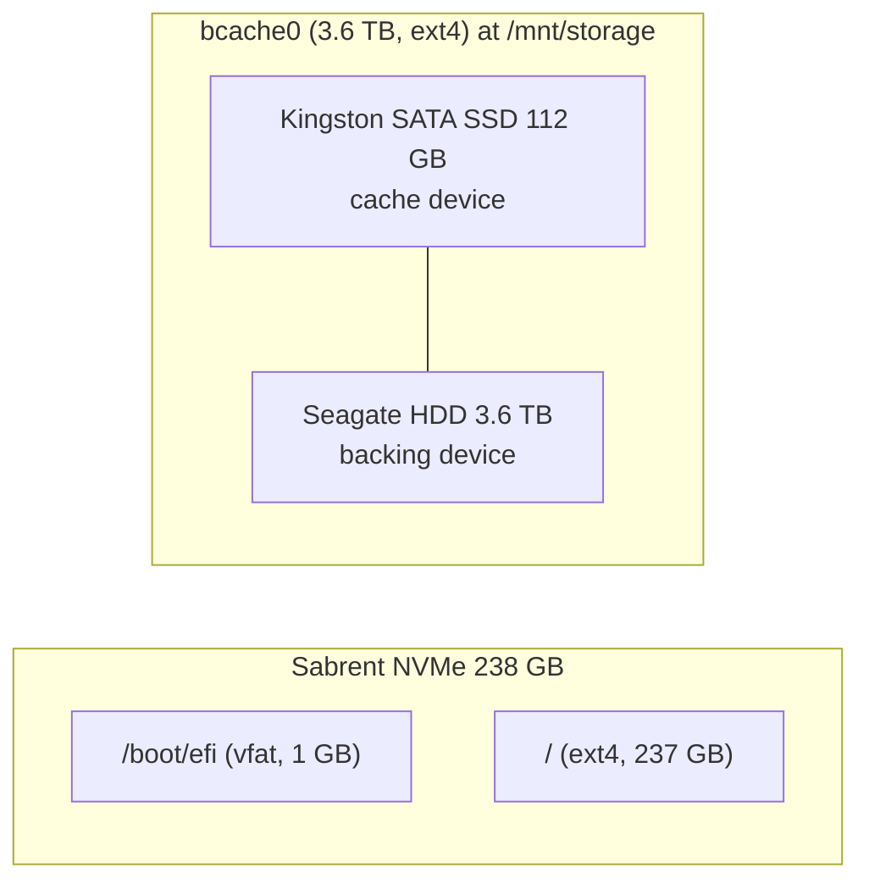
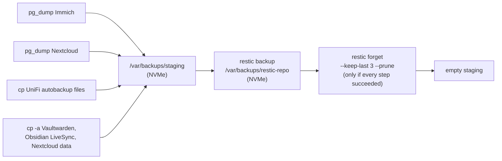

# Storage and backups

## Disk layout



| Mount | Device | FS | Size | Used | Holds |
|---|---|---|---|---|---|
| `/` | NVMe partition 2 | ext4 | 233 GB | 93 GB (42%) | OS, Docker images and named volumes, backup repo, 8 GB swap file |
| `/boot/efi` | NVMe partition 1 | vfat | 1.1 GB | 6 MB | EFI system partition |
| `/mnt/storage` | `bcache0` | ext4 | 3.6 TB | 18 GB (1%) | Application data |

`/mnt/storage` is mounted by UUID with `defaults,nofail`, so the host still boots if the data volume is missing. Containers that bind-mount paths under it would then start against an empty directory on the root disk; check `findmnt /mnt/storage` after any storage incident before starting stacks.

There is no RAID. Each tier is a single disk.

## bcache

| Setting | Value |
|---|---|
| Backing device | 3.6 TB HDD (whole disk) |
| Cache device | 112 GB SATA SSD (whole disk) |
| Cache mode | `writeback` |
| `writeback_percent` | 10 |
| `sequential_cutoff` | 4 MB (larger sequential I/O bypasses the cache) |
| Bucket size | 512 KiB |
| State at audit | `dirty`, 444 KiB waiting to be written back |
| Cache hit ratio (lifetime) | 90% |
| Cache space available | 95% |

**What writeback means here.** Writes are acknowledged once they are on the SSD and flushed to the HDD afterwards. If the SSD fails while dirty data is outstanding, the filesystem on the HDD is missing those writes and may be inconsistent. With a single cache SSD and a single backing disk, this tier optimises for speed and capacity, not durability. Backups are the durability layer.

Useful checks:

```bash
cat /sys/block/bcache0/bcache/state            # clean | dirty | inconsistent
cat /sys/block/bcache0/bcache/dirty_data
cat /sys/block/bcache0/bcache/cache_mode
cat /sys/block/bcache0/bcache/stats_total/cache_hit_ratio
```

Before removing or replacing the SSD, switch to `writethrough` and wait for `dirty_data` to reach zero:

```bash
echo writethrough | sudo tee /sys/block/bcache0/bcache/cache_mode
watch cat /sys/block/bcache0/bcache/dirty_data
```

## Where data lives

| Data | Location | Disk |
|---|---|---|
| Immich photos, videos, thumbnails | `/mnt/storage/immich/library` (17 GB) | bcache |
| Immich PostgreSQL | `/mnt/storage/immich/postgres` | bcache |
| Nextcloud user files | `/mnt/storage/nextcloud` (213 MB) | bcache |
| Nextcloud app code, PostgreSQL, Redis | volumes `nextcloud_aio_*` | NVMe |
| Vaultwarden SQLite, attachments, keys | `/mnt/storage/vaultwarden/data` | bcache |
| Obsidian LiveSync: CouchDB data, CLI database, plain-Markdown vault copy, secrets | `/mnt/storage/obsidian-livesync` | bcache |
| n8n SQLite, encryption key, workflows | `/mnt/storage/n8n` | bcache |
| Quartus build context, desktop home, projects | `/mnt/storage/quartus` | bcache |
| Nginx Proxy Manager config and certificates | volumes `homelab-core_npm_data`, `homelab-core_npm_letsencrypt` | NVMe |
| Portainer state | volume `homelab-core_portainer_data` | NVMe |
| SnapOtter state | volume `SnapOtter-data` | NVMe |
| Immich ML model cache | volume `immich_model-cache` | NVMe |
| UniFi configuration and database | `uosserver` user's Podman storage | NVMe |
| Compose files and `.env` files | `~/homelab-core`, `~/immich`, `~/n8n`, `~/nextcloud`, and beside the data for Obsidian LiveSync, Vaultwarden, Quartus | both |
| restic repository | `/var/backups/restic-repo` | NVMe |

## Health monitoring

SMART status on 2026-10-13:

| Disk | Health | Power-on time | Wear | Errors | Notes |
|---|---|---|---|---|---|
| NVMe (boot) | Passed | 8,402 h | 6% used, 100% spare, 13.6 TB written | 0 media errors | 160 unsafe shutdowns over 1,301 power cycles |
| SATA SSD (cache) | Passed | 8,620 h | 91% life left, 3.7 TB host writes | 0 uncorrectable, 0 CRC | Last extended self-test was aborted |
| HDD (data) | Passed | 20,439 h | Load cycle count 485,123, past the drive's rating | 0 reallocated, 0 pending, 0 uncorrectable | No self-test has ever been run |

bcache reports zero I/O errors on both the cache and backing device.

The HDD's surface is healthy but its head-parking mechanism is heavily worn; see [finding 18](findings.md#18-data-disk-is-past-its-rated-load-cycles).

- `smartd` scans all three disks (`DEVICESCAN`) and mails `root` on problems. No mail transport is configured on the host, so those messages are only visible in the journal. It does not schedule self-tests.
- `fstrim.timer` trims weekly; `e2scrub_all.timer` checks ext4 metadata weekly.
- The kernel log for the current boot shows no I/O, ext4, or bcache errors.

## Backups

### Design

[`scripts/homelab-backup.sh`](../scripts/homelab-backup.sh) runs from `homelab-backup.timer` every night at 00:00 as root.



| Step | Detail |
|---|---|
| Database dumps | `pg_dump` inside `immich_postgres` and `nextcloud-aio-database` |
| UniFi | Copies the controller's own scheduled `.unf` backup files from the UniFi OS Server volume |
| File copies | `/mnt/storage/vaultwarden`, `/mnt/storage/obsidian-livesync`, `/mnt/storage/nextcloud` copied to staging |
| Repository | restic 0.18, local repo on the NVMe, password in `/root/.restic-password` |
| Retention | last 3 snapshots |
| Failure handling | Each source is an independent step. A failed step is logged and the rest still run; the script exits non-zero at the end, and pruning is skipped so a partial run cannot evict a good snapshot |
| Staging | `/var/backups/staging`, mode 700, emptied before and after each run |

### Current state

Working as of 2026-10-13. The job failed every night from 2026-09-22 until it was fixed that day; see the [changelog](../CHANGELOG.md#fixed-the-nightly-backup-finding-1). The repository holds three snapshots (2026-09-20, 2026-09-21, 2026-10-13), and `restic check` reports no errors. There is a gap with no snapshots between 09-21 and 10-13.

### Coverage

| Data | In the backup? |
|---|---|
| Immich database | Yes (dump) |
| Immich photos and videos | **No** |
| Nextcloud database | Yes (dump) |
| Nextcloud user files | Yes (copy) |
| Vaultwarden | Yes (file copy of a live SQLite database) |
| Obsidian LiveSync | Yes (file copy of CouchDB data and of the plain-Markdown vault mirror) |
| UniFi | Yes (the controller's own backup files; the newest is dated 2026-10-01) |
| n8n | **No** |
| Nginx Proxy Manager, Portainer | **No** |
| Compose files, `.env` files, scripts, systemd units | **No** (sanitised copies are in this repo; secrets are not) |

Every copy is on the same machine as the data, and the repository shares a disk with the operating system. There is no off-site or off-host copy. See [finding 2](findings.md#2-backups-do-not-protect-against-losing-the-machine).

### Other backups that exist

- Immich writes its own scheduled database dumps to `/mnt/storage/immich/library/backups`.
- It lives on the same bcache volume as the data it protects.

### Restore

These procedures follow from the backup layout. They have not been exercised as a full restore test.

```bash
# As root
export RESTIC_REPOSITORY=/var/backups/restic-repo
export RESTIC_PASSWORD_FILE=/root/.restic-password

restic snapshots
restic restore latest --target /tmp/restore
# files appear under /tmp/restore/var/backups/staging/
```

| Service | Procedure |
|---|---|
| Immich database | Stop `immich_server` and `immich_machine_learning`; `docker exec -i immich_postgres psql -U immich -d immich < immich-postgres.sql` into an empty database; start the stack. Follow Immich's restore documentation for the exact drop and create steps for the running version |
| Nextcloud database | Stop the containers from the AIO interface; restore `nextcloud-postgres.sql` into `nextcloud-aio-database`; copy `nextcloud-data` back to `/mnt/storage/nextcloud` preserving ownership (`www-data`); start containers and run `occ maintenance:data-fingerprint` |
| Vaultwarden | Stop the container; replace `/mnt/storage/vaultwarden/data` with the restored copy; start |
| Obsidian LiveSync | The `vault/` folder is an ordinary Obsidian vault and can be opened or copied directly. To restore the sync server: `docker compose down` in `/mnt/storage/obsidian-livesync`, replace the directory with the restored copy, `docker compose up -d`. If CouchDB itself is lost, start an empty one, rerun `couchdb-init.sh`, and run `livesync-cli --vault /vault rebuild --force` from the vault copy |
